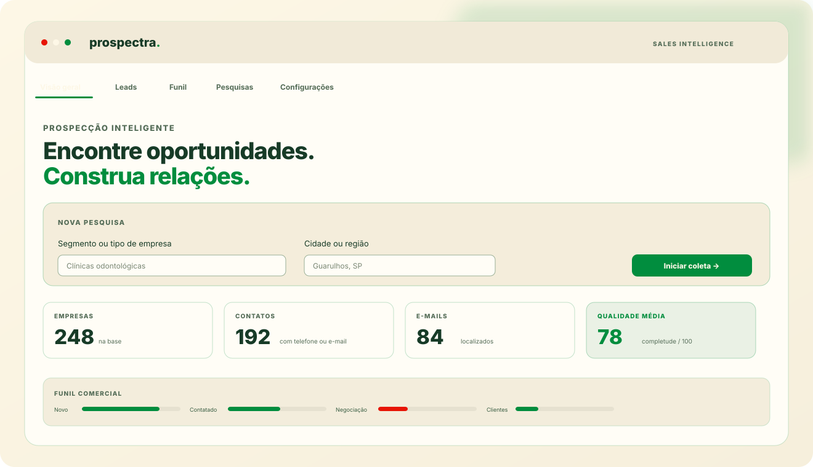

  
  <h1>Prospectra</h1>
  
<strong>Sales Intelligence para prospecção local.</strong>

  
Encontre empresas. Enriqueça contatos. Organize oportunidades. Acompanhe cada próximo passo.

  

    
    
    
    
    
    
  

  

    <a href="docs/GUIA-RAPIDO.md">Guia rápido</a> ·
    <a href="CHANGELOG.md">Histórico de versões</a> ·
    <a href="docs/SOLUCAO-DE-PROBLEMAS.md">Ajuda e problemas</a> ·
    <a href="docs/ARQUITETURA.md">Arquitetura</a> ·
    <a href="docs/IDENTIDADE-VISUAL.md">Identidade visual</a>
  

---

## Prévia da interface

Composição visual ilustrativa. Os números exibidos são fictícios e não representam resultados de clientes ou testes de desempenho.

## O que é o Prospectra?

O Prospectra transforma pesquisas públicas do Google Maps em uma base estruturada de prospecção. A extensão coleta informações empresariais disponíveis na página, pode enriquecer os registros com dados publicados nos sites das empresas e oferece ferramentas para organizar o relacionamento comercial.

A versão 2.0.0 expande o produto para além da captura: inclui banco local IndexedDB, funil de vendas, histórico de interações, follow-ups, pesquisas em fila, relatórios, importação/exportação e conectores opcionais.

**O princípio do produto é local-first:** sem ativar uma integração externa, os dados permanecem no perfil local do Chrome. Sincronização em nuvem e envio ao Google Sheets são ações configuradas e iniciadas pelo próprio usuário.

## Visão do produto

### Captura e enriquecimento

- Coleta progressiva das fichas de empresas que o Google Maps apresenta na página.
- Filtros de nota mínima e quantidade configurável.
- Identificação por Place ID quando o identificador está disponível.
- Detecção de mudanças no DOM, múltiplos seletores e área de rolagem.
- Pausar, continuar e cancelar a coleta, com checkpoint persistente para retomar pesquisas interrompidas.
- Recuperação de abertura de ficha com nova tentativa controlada.
- Diagnóstico técnico copiável para investigar falhas.
- Interrupção segura quando aparecem CAPTCHA, tela de verificação ou limitação de acesso.
- Enriquecimento opcional com e-mails, telefones, CNPJ numérico/alfanumérico, redes sociais, horários e metadados básicos do site.
- Verificação de disponibilidade HTTP e consulta DNS/MX do domínio.

### CRM e relacionamento

- Funil: Novo, Analisado, Contatado, Interessado, Negociação, Cliente e Perdido.
- Quadro Kanban com movimentação por arrastar e soltar.
- Histórico de ligações, reuniões, mensagens e observações.
- Follow-ups com alertas opcionais do Chrome.
- Lista de não contatar.
- Etiquetas, responsável comercial e modelos de abordagem.
- Pontuação de qualidade configurável, de 0 a 100.
- WhatsApp com mensagem pré-preenchida, sempre com envio manual pelo usuário.

### Dados e relatórios

- Banco local IndexedDB com migração automática dos registros antigos.
- Deduplicação por Place ID, URL, telefone, nome e endereço.
- Histórico de avaliações e origem/confiança dos campos.
- Dashboard por etapa comercial e região.
- Exportação Excel e CSV, incluindo campos selecionáveis e mapeamentos básicos para CRMs.
- Importação de Excel XLSX, CSV e restauração de backup JSON.
- Backup completo de leads, interações, pesquisas e configurações.

### Integrações opcionais

- **Google Sheets:** envio para um Web App próprio do Google Apps Script.
- **Supabase:** autenticação e sincronização de leads entre dispositivos usando RLS, validação estrita da URL do projeto e paginação com contagem exata.
- Não é necessário configurar essas integrações para usar a captura ou o CRM local.

> **Importante:** o Prospectra lê a interface pública carregada no navegador. Ele não usa uma API oficial de dados do Google Maps, não garante que todos os resultados sejam apresentados e não contorna CAPTCHA, login, bloqueios, paywalls ou limites do serviço.

## Instalação no Chrome

### Opção A — Instalação para uso

1. Na página do repositório, clique em **Code → Download ZIP**.
2. Extraia o arquivo ZIP em uma pasta permanente.
3. Abra chrome://extensions no Chrome.
4. Ative **Modo do desenvolvedor**.
5. Clique em **Carregar sem compactação**.
6. Selecione a pasta extraída que contém manifest.json.
7. Fixe o ícone do Prospectra na barra do Chrome.
8. Abra o painel lateral pelo ícone da extensão.

### Opção B — Instalação para desenvolvimento

Requer Git e Node.js 20.12 ou superior para executar os testes de importação XLSX.

~~~powershell
git clone https://github.com/Louissdk/Prospectra.git
cd Prospectra
npm install --no-save --no-package-lock jsdom@26.1.0
npm run check
npm test
~~~

Depois, carregue a pasta do repositório em chrome://extensions usando **Carregar sem compactação**.

## Tutorial: sua primeira prospecção

1. Abra o Prospectra e vá para **Visão geral**.
2. Digite um segmento, por exemplo, clínicas odontológicas.
3. Informe a região, por exemplo, Guarulhos, SP.
4. Defina uma meta de leads e a nota mínima.
5. Deixe **Pular empresas já salvas** ativo para evitar reprocessar registros conhecidos.
6. Clique em **Abrir pesquisa no Maps** e aguarde os cartões carregarem.
7. Volte ao painel e clique em **Iniciar coleta**.
8. Pause ou continue a tarefa quando necessário. Os lotes confirmados são salvos progressivamente.
9. Acesse **Leads** ou **Funil** para organizar os registros.
10. Exporte os dados ou faça um backup em **Configurações**.

Para várias cidades ou segmentos, cadastre pesquisas em **Pesquisas** e execute a fila. Consulte o [tutorial completo](docs/GUIA-RAPIDO.md).

## Atualizar sua instalação

Se você instalou a partir de um clone Git, execute no PowerShell:

~~~powershell
git -C "C:\Users\luisf\Downloads\Prospectra" pull --ff-only origin main
~~~

Depois abra chrome://extensions, clique em **Recarregar** no Prospectra e atualize a página do Google Maps.

Se instalou pelo ZIP, baixe a versão atualizada, extraia em uma pasta nova e carregue a nova pasta. Faça backup antes de remover a instalação antiga.

## Integrações

| Integração | Para que serve | Configuração |
|---|---|---|
| Google Sheets | Enviar e atualizar registros em uma planilha própria | [Tutorial Apps Script](docs/integrations/google-sheets.md) |
| Supabase | Sincronizar leads entre instalações e dispositivos | [Tutorial Supabase](docs/integrations/supabase.md) |
| HubSpot / Pipedrive / Salesforce | Exportação CSV com cabeçalhos compatíveis básicos | Menu Configurações → Exportação |

As integrações não são ativadas automaticamente. A extensão pede permissão de host quando você configura e inicia uma integração.

## Documentação

| Documento | Conteúdo |
|---|---|
| [Guia rápido](docs/GUIA-RAPIDO.md) | Instalação, primeira coleta, CRM, exportação e backup |
| [Histórico de versões](CHANGELOG.md) | O que cada atualização trouxe |
| [Arquitetura](docs/ARQUITETURA.md) | Componentes, fluxo de dados e armazenamento |
| [Solução de problemas](docs/SOLUCAO-DE-PROBLEMAS.md) | Diagnósticos e correções comuns |
| [Privacidade e proteção de dados](docs/PRIVACIDADE-E-LGPD.md) | Dados tratados, permissões e controles |
| [Google Sheets](docs/integrations/google-sheets.md) | Implantação do Apps Script |
| [Supabase](docs/integrations/supabase.md) | Autenticação, schema e sincronização |
| [Schema SQL](docs/supabase/schema.sql) | Tabela, índices e políticas RLS |
| [Roadmap](docs/ROADMAP.md) | Funcionalidades concluídas e próximas evoluções |
| [Apresentação comercial](docs/MATERIAIS-COMERCIAIS.md) | Posicionamento, público-alvo e checklist de venda |
| [Checklist de release](docs/RELEASE-CHECKLIST.md) | Processo de validação e publicação |
| [Contribuição](CONTRIBUTING.md) | Padrões para desenvolvimento |
| [Segurança](SECURITY.md) | Relato responsável de vulnerabilidades |

## Arquitetura

~~~mermaid
flowchart TD
  A[Google Maps no Chrome] --> B[content.js]
  B --> C[Leitura sequencial e checkpoints]
  C --> D[service-worker.js]
  D --> E[IndexedDB]
  E --> F[sidepanel.js]
  F --> G[Dashboard e CRM]
  F --> H[Excel / CSV / JSON]
  F --> I[Google Sheets opcional]
  F --> J[Supabase opcional]
  D --> K[Enriquecimento de sites públicos]
  K --> E
~~~

**Stack:** Chrome Extension Manifest V3, JavaScript ES Modules, Chrome Storage para migração legada, IndexedDB para a base atual, Node.js para testes e GitHub Actions para validação contínua.

## Limitações conhecidas

- A interface do Google Maps muda sem aviso. Os seletores alternativos reduzem o risco, mas não garantem compatibilidade permanente.
- Quantidade solicitada não significa quantidade de empresas existentes. O Maps pode apresentar menos resultados do que a meta.
- A coleta é sequencial para preservar estabilidade. Pesquisas longas podem demorar.
- A busca de contatos depende de dados publicados nos sites. Alguns sites bloqueiam requisições ou renderizam conteúdo somente via JavaScript.
- A consulta MX indica se o domínio publica registros de recebimento de e-mail; não comprova a existência de uma caixa postal nem a entrega de mensagens.
- A importação suporta XLSX, CSV e backup JSON. Arquivos XLSX protegidos por senha ou estruturas ZIP64 não são suportados.
- A cobertura regional mostra a distribuição da base por cidade/região e fornece links para pesquisar no Maps; não é um mapa geográfico com coordenadas.
- A sincronização Supabase não propaga exclusões de registros. Faça backup antes de operações de limpeza.
- Testes automatizados usam DOM simulado; eles não substituem testes manuais com uma sessão real do Google Maps.

## Privacidade e uso responsável

Use apenas dados necessários à finalidade comercial legítima, respeite solicitações de não contato e as regras aplicáveis de proteção de dados. A extensão inclui uma lista local de não contatar, mas a decisão e a base legal para cada abordagem continuam sendo responsabilidade do operador.

Leia a [Política de privacidade](PRIVACY.md) e o [guia de privacidade e proteção de dados](docs/PRIVACIDADE-E-LGPD.md).

## Licença

O repositório é público para inspeção e avaliação, mas o código e a marca Prospectra permanecem proprietários. A publicação pública não concede autorização para revenda, redistribuição ou uso comercial do código. Consulte [LICENSE.md](LICENSE.md).

---

  <strong>Prospectra</strong> 
  Do primeiro resultado à próxima conversa comercial. 
  Não afiliado, endossado ou patrocinado pelo Google.

